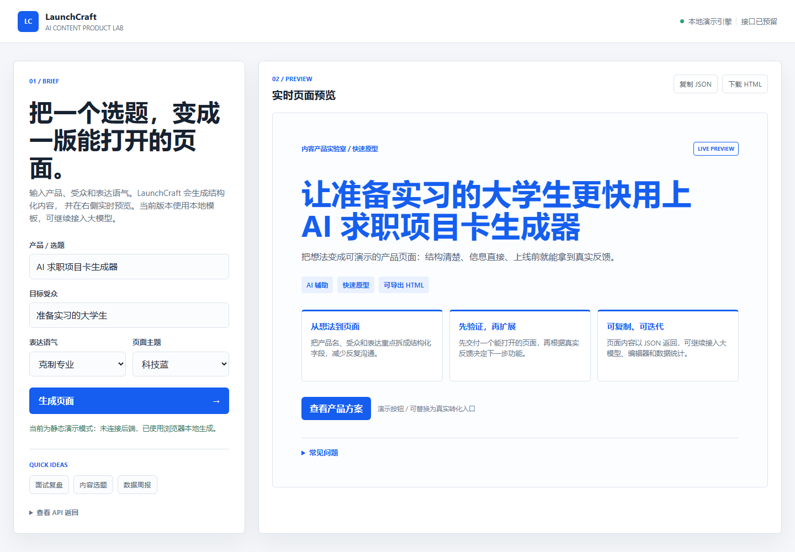

# LaunchCraft

一个面向内容团队的 AI 产品原型：输入选题、目标受众、语气和主题，生成一版可预览的落地页内容，并支持复制 JSON 或下载独立 HTML。

这个项目不是把 AI 当成一个聊天窗口，而是把“想法 -> 结构化内容 -> 可展示页面 -> 可交付文件”串成一条完整链路。



## 功能

- 选题、受众、语气、主题四项输入
- Python HTTP API 生成结构化页面内容
- 前端实时预览标题、卖点、CTA 和 FAQ
- 支持复制 API 返回 JSON
- 支持下载独立 HTML 文件
- 响应式布局，支持桌面和手机
- 本地模板引擎可直接运行，不需要 API Key

## 启动

在项目目录执行：

```powershell
py server.py
```

然后打开：

```text
http://127.0.0.1:8000
```

如果 8000 端口被占用，可以指定其他端口：

```powershell
$env:PORT=8010
py server.py
```

## GitHub Pages 静态预览

`docs/` 目录是给 GitHub Pages 用的静态版本：

- 不需要 Python 后端
- 浏览器本地生成内容
- 保留复制 JSON 和下载 HTML 功能

上传仓库后，在 GitHub 的 `Settings -> Pages` 中选择：

```text
Source: Deploy from a branch
Branch: main
Folder: /docs
```

生成后的地址格式是：

```text
https://qiutaotao666.github.io/launchcraft-ai/
```

## 目录

```text
ai-launchcraft/
  server.py
  static/
    index.html
    styles.css
    app.js
```

## API

```text
POST /api/generate
Content-Type: application/json
```

请求示例：

```json
{
  "product": "AI 求职项目卡生成器",
  "audience": "准备实习的大学生",
  "tone": "professional",
  "theme": "blue"
}
```

返回内容包含：

- eyebrow
- headline
- subheadline
- tags
- features
- cta
- faq
- prompt
- engine

`prompt` 字段是预留的 LLM 提示词。当前版本使用本地模板引擎，后续可以把 `generate_content` 替换为真实的大模型调用。

## 技术结构

```text
浏览器表单
  -> POST /api/generate
  -> Python 内容生成器
  -> JSON 结构化内容
  -> 前端渲染预览
  -> 复制 JSON / 下载 HTML
```

## 面试时怎么讲

```text
这个项目解决的是内容团队从选题到可展示页面的快速转化问题。
我把需求拆成产品名、受众、语气和主题四个参数，后端返回结构化内容，
前端负责即时预览和导出。当前使用本地模板生成以保证 Demo 可运行，
同时保留了 LLM prompt 和接口扩展点。这个项目主要体现了我对
需求拆解、前后端接口、状态管理和快速交付的理解。
```

## 当前限制

- 当前使用本地模板生成，不依赖外部模型
- 还没有接入用户登录、数据库和多项目管理
- 还没有做真实部署和自动化测试

如果面试被问到“这是不是 AI”，可以如实回答：

```text
当前 Demo 使用本地模板保证离线可运行，AI 接口已经预留；
下一步会把生成器替换成 LLM，并增加结果评分和二次编辑。
```
